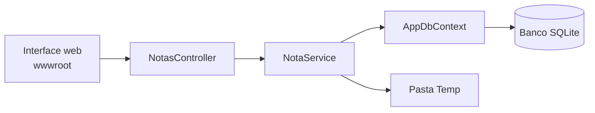
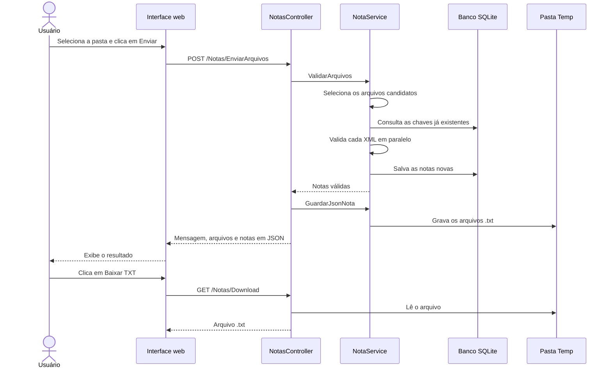

# Arquitetura

## Visão geral

O NFirst é uma aplicação única em ASP.NET Core (.NET 10) que atende a API e a interface web. A interface é composta por arquivos estáticos servidos pela própria aplicação, e os dados são armazenados em um banco SQLite local, isto é, não há servidor de banco de dados separado.

Os critérios usados para aceitar ou descartar uma nota estão descritos em [regras-de-negocio.md](regras-de-negocio.md).

## Camadas

| Camada | Local | Responsabilidade |
| :--- | :--- | :--- |
| Interface web | `wwwroot/` | Permite selecionar a pasta, envia os arquivos para a API, exibe o resultado em JSON e baixa os arquivos gerados. |
| Controller | `Controllers/` | Recebe as requisições HTTP, aciona o service e monta a resposta, incluindo a mensagem de resumo do envio. |
| Service | `Services/` | Concentra a seleção dos arquivos, a validação das notas, o controle de duplicidade, a gravação e a exportação das chaves. |
| Dados | `Data/`, `Models/`, `Migrations/` | Define a entidade da nota fiscal, o acesso ao banco (Entity Framework Core) e o histórico de alterações do banco. |
| Configuração | `Program.cs` | Registra os serviços, aplica as migrations e define o pipeline da aplicação. |

A comunicação entre as camadas acontece em um único sentido: a interface chama o controller, o controller chama o service, e o service acessa o banco de dados e a pasta `Temp/`.

## Fluxo de um envio

## Endpoints

| Rota | Descrição | Usado pela interface |
| :--- | :--- | :---: |
| `POST /Notas/EnviarArquivos` | Valida os arquivos XML, salva as notas válidas, gera os arquivos de exportação e retorna a mensagem de resumo, os nomes dos arquivos e as notas em JSON. | Sim |
| `GET /Notas/Download/{nome}` | Retorna um arquivo gerado, a partir do nome informado na resposta do envio. Retorna o erro 404 se o arquivo não existir. | Sim |
| `POST /Notas/ValidarArquivos` | Valida os arquivos XML, salva as notas válidas e retorna a lista de notas. Não gera os arquivos de exportação. Apesar do nome, também grava no banco de dados. | Não |
| `GET /Notas` | Retorna todas as notas salvas. | Não |
| `POST /Notas` | Salva uma nota enviada em JSON, sem passar pelas validações dos arquivos XML. | Não |

A resposta de `EnviarArquivos` possui três campos:

| Campo | Descrição |
| :--- | :--- |
| `mensagem` | Resumo do envio, com a quantidade de arquivos recebidos, de notas já processadas e de notas salvas. |
| `arquivos` | Nomes dos arquivos de exportação gerados. |
| `notas` | Lista das notas válidas, com `chave`, `serie` e `mesAno`. |

Todos os endpoints estão documentados no Swagger, disponível em ambiente de desenvolvimento.

## Configuração da aplicação

No `Program.cs`, a aplicação executa as seguintes etapas:

| Ordem | Etapa | Descrição |
| :---: | :--- | :--- |
| 1 | Registro dos serviços | Controllers, `AppDbContext` com SQLite, `NotaService` e Swagger. |
| 2 | Migrations | As migrations pendentes são aplicadas na inicialização, e o banco é criado na primeira execução. |
| 3 | Swagger | Habilitado somente no ambiente `Development`. |
| 4 | Redirecionamento HTTPS | Redireciona as requisições HTTP para HTTPS quando a porta HTTPS está ativa. |
| 5 | Arquivos estáticos | Serve a interface web da pasta `wwwroot/`. |
| 6 | Controllers | Mapeia os endpoints da API. |

## Decisões de projeto

| Decisão | Motivo |
| :--- | :--- |
| Aplicação única, com API e interface web | Permite executar tudo com um único comando, sem configurar servidores separados. |
| SQLite como banco de dados | Dispensa a instalação de um servidor de banco de dados. |
| Migrations aplicadas na inicialização | A pessoa que executa o projeto não precisa rodar comandos adicionais para criar o banco. |
| Validação dos arquivos em paralelo | Reduz o tempo de processamento de pastas com muitos arquivos. As chaves já existentes são carregadas do banco enquanto os arquivos são lidos. |
| Descarte de arquivos pelo nome | Evita abrir arquivos que, pelo nome, já se sabe que não são NFC-e. |
| Leitura segura do XML | A leitura recusa XML com definição de tipo de documento (DTD), o que reduz riscos de segurança no processamento de arquivos enviados. |
| Gravação das notas em lote | As notas novas são gravadas de uma só vez, ao final da validação. |
| Download restrito à pasta `Temp/` | O endpoint utiliza apenas o nome do arquivo informado, impedindo o acesso a arquivos de outras pastas. |
| Swagger somente em desenvolvimento | Evita expor a documentação da API fora do ambiente de desenvolvimento. |

## Limitações conhecidas

| Tema | Descrição |
| :--- | :--- |
| Autenticação | Os endpoints não exigem autenticação. O projeto se destina a uso local ou de desenvolvimento. |
| Envio em uma única requisição | Todos os arquivos da pasta são enviados e processados em uma única requisição, sujeita aos limites de tamanho do servidor. |
| Arquivos exportados | A pasta `Temp/` não é limpa automaticamente. Um novo envio com notas do mesmo mês, ano e CNPJ substitui o arquivo anterior. |
| Registro de erros | Os erros de leitura e os arquivos descartados são registrados apenas no console, e não são informados ao usuário. |
| Campo `serie` | Possui valor fixo `65`, que corresponde ao modelo da nota e não à série informada na chave de acesso. |
| Crédito | A aplicação não calcula o crédito. Armazena apenas o valor total da nota. |
